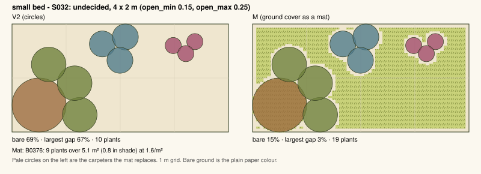
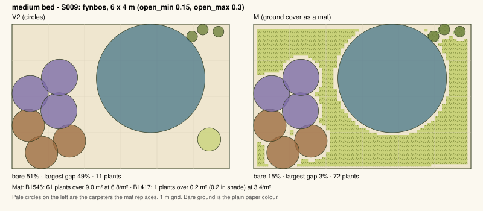
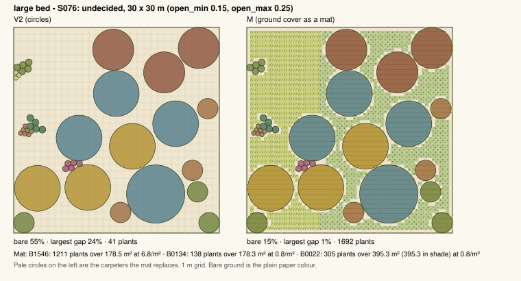

# Ground cover as a mat - V0 / V2 / M

**Measurement only, in memory, on branch `coverage-test`. Nothing merged or deployed.**

Rulebook as imported: `098c8d085f61`. 100 seeded scenarios, the same for every version.
Figures are medians with the 10th-90th percentile in brackets, over the plans produced.

| version | what it changes |
|---|---|
| **V0** | the engine as imported |
| **V2** | contact-point preference 0 |
| **M** | V2 + ground cover laid as a mat (spacing 0.6 x spread, ASSUMPTION) |

## All scenarios

| | V0 | V2 | M |
|---|---|---|---|
| plans produced | 95 / 100 | 95 / 100 | 95 / 100 |
| bare ground | 0.347 (0.239-0.497) | 0.343 (0.243-0.477) | 0.150 (0.100-0.200) |
| real cover (1 - bare) | 0.653 (0.503-0.761) | 0.657 (0.523-0.757) | 0.850 (0.800-0.900) |
| engine cover (summed canopy) | 0.665 (0.506-0.777) | 0.668 (0.528-0.773) | 0.850 (0.800-0.900) |
| bare below style open_min | 0 / 95 | 0 / 95 | 0 / 95 |
| bare within open_min-open_max | 27 / 95 | 28 / 95 | 95 / 95 |
| bare above style open_max | 68 / 95 | 67 / 95 | 0 / 95 |
| bare <= 20% | 3 / 95 | 3 / 95 | 95 / 95 |
| bare <= 10% | 0 / 95 | 0 / 95 | 24 / 95 |
| largest empty patch | 0.165 (0.079-0.360) | 0.150 (0.073-0.321) | 0.018 (0.005-0.064) |
| quadrant CV | 0.212 (0.088-0.425) | 0.156 (0.074-0.376) | 0.033 (0.015-0.065) |
| Z (selection) | 0.9196 (0.8389-0.9790) | 0.9293 (0.8211-0.9788) | 0.9293 (0.8211-0.9788) |
| plans with a hard violation (specimens) | 0 / 95 | 0 / 95 | 0 / 95 |
| plans over H2's s_max (species) | 0 / 95 | 0 / 95 | 4 / 95 |
| run time per plan, ms | 462 (400-786) | 513 (398-1599) | 460 (387-846) |
| plants to buy | 20 (9-45) | 19 (10-46) | 85 (25-511) |

Bare ground is read on a 60 x 60 grid of cell centres (the mat's own raster),
so overlapping canopies count once and a mat cell counts as covered. Largest
empty patch and quadrant CV use the 20 x 20 grid of the earlier coverage reports.
Engine cover sums canopy areas and counts overlaps twice; it is shown
only because it is the figure the app reports. Z is the selection's score:
the mat runs after the selection is accepted (same Z as V2 in 95 of 95
plans), so Z does not score the mat species.

## How the mat is laid (all ASSUMPTION, in memory)

- Specimens stay circles, placed exactly as V2 places them; the mat runs after
  the placement is accepted, so it cannot trigger the fail rule.
- Zones on a 60 x 60 raster. Sun zone: ground under no specimen canopy, of which
  the style's open_min is kept bare - taken from the narrowest gaps, so bare ground
  is a thin margin round each specimen - and the rest is the sun mat. Shade zone:
  ground under an L1 canopy and no other specimen.
- Eligible: every true carpeter (L6, ground-cover or moss type) in the bed's
  Stage 0 pool. Ranked: the search's own carpeters first, then Stage 1 score, ties
  in a seeded random order (plan seed without wind). Options 2 and 3 take species
  an earlier option used only when nothing else is eligible.
- Count by the rulebook's H2 bands (small < 10 m2, medium 10-50, large > 50):
  small 1 (shade patch only if that species is shade-tolerant); medium 1 sun + 1
  shade if there is a shade zone; large 2 sun + 1 shade if there is a shade zone.
  The shade species must be shade-tolerant (sun = part or sheltered) or the shade
  patch is not laid.
- Patches never mix: the sun mat is cut into equal bands across the long axis.
- Quantity = area x 1 / (0.6 x spread)^2. Mat species sit outside H2, H3 and H5.

| | M |
|---|---|
| plans where the mat was laid | 95 / 95 |
| ... where the search had picked a carpeter itself | 60 |
| ... where the mat added a carpeter the search had not picked | 35 |
| search's carpeters the mat rules took out of the plan | 20 in 16 plans |
| mat species per plan: 1 / 2 / 3 | 44 / 32 / 19 |
| plans with a shade patch under L1 | 78 |
| shade patch, m2 (those plans) | 7.1 (0.4-47.7) |
| sun mat area, m2 | 4.2 (1.5-21.2) |
| sun mat as a share of the bed | 0.250 (0.129-0.440) |
| mat plants | 66 (9-490), most in one plan 7812 |
| bare ground, these plans: V2 -> M | 0.343 (0.243-0.477) -> 0.150 (0.100-0.200) |
| largest gap, these plans: V2 -> M | 0.150 (0.073-0.321) -> 0.018 (0.005-0.064) |
| plants to buy, these plans: V2 -> M | 19 (10-46) -> 85 (25-511) |

## Which species form the mat

| | option 1 |
|---|---|
| distinct mat species across the scenarios | 52 |
| most common | Stachys aethiopica (B0376): 14 of 95 plans with a mat (15%) |
| next most common | Chaenostoma cordatum (B2160) 12; Coleus neochilus (B2481) 12; Coleus subspicatus (B1125) 11 |

No species is the mat in more than 25% of plans with a mat.

## Across the three options

| | plans with a mat | distinct mat species | most common |
|---|---|---|---|
| option 1 | 95 | 56 | Stachys aethiopica (B0376): 14 (15%) |
| option 2 | 93 | 56 | Stachys aethiopica (B0376): 11 (12%) |
| option 3 | 90 | 67 | Stachys aethiopica (B0376): 12 (13%) |

Scenarios with a mat in two or more options: 93. Of those, no mat species repeated across the options: 85.
A repeat happens only when the bed's pool holds too few eligible carpeters to give every option its own.

## Figures (V2 left, M right, same seed)

## Conclusion: not adopted

**Decision (owner, 13 October 2026): the mat model is rejected on design
review and will not be merged.** Two reasons:

- **It reads as a uniform carpet.** Every open gap is filled with the
  same textured ground cover, which looks like lawn, not a planted bed.
- **The quantities are unrealistic.** Area x density at 0.6 x spread
  takes the median plan from 19 to 85 plants (90th percentile 511) and
  one bed to 7,812. Most of the excess is the shade patch under trees,
  which adds plants but no cover.

| | V0 | V2 | M (V2 + mat) |
|---|---|---|---|
| plans produced | 95 / 100 | 95 / 100 | 95 / 100 |
| bare ground, median (10th-90th) | 0.347 (0.239-0.497) | 0.343 (0.243-0.477) | 0.150 (0.100-0.200) |
| bare within open_min-open_max | 27 | 28 | 95 |
| bare <= 20% | 3 | 3 | 95 |
| largest empty patch | 0.165 | 0.150 | 0.018 |
| quadrant CV | 0.212 | 0.156 | 0.033 |
| Z (selection) | 0.9196 | 0.9293 | 0.9293 |
| hard violations (specimens) | 0 | 0 | 0 |
| plans over H2's s_max | 0 | 0 | 4 |
| run time per plan, ms | 526 | 513 | 498 |
| plants to buy, median (90th) | 20 (45) | 19 (46) | 85 (511) |

The mat met the cover target in every plan, but it did so by changing
what the bed is. The code stays on branch `coverage-test` (commit
`4a1ba4f`) as evidence; the figures are in `figures/mat_study/` as SVG
and PNG.
